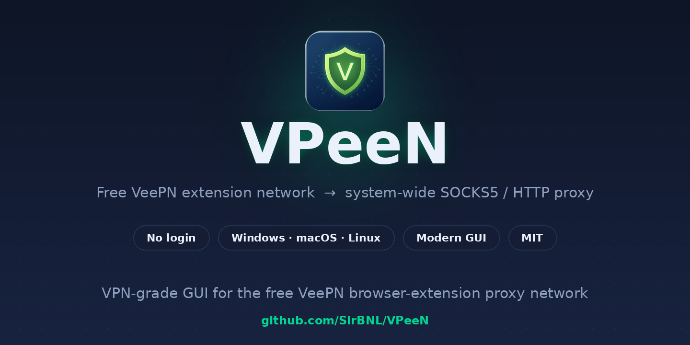
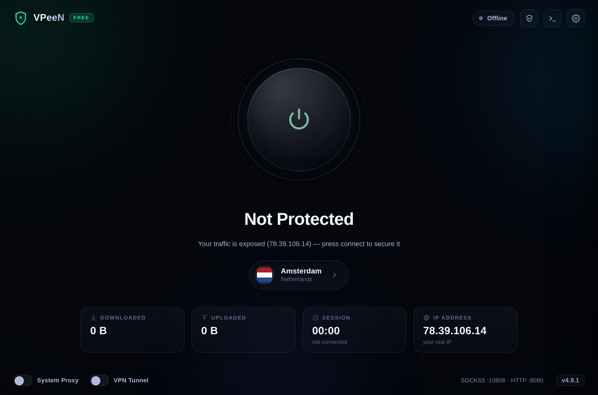
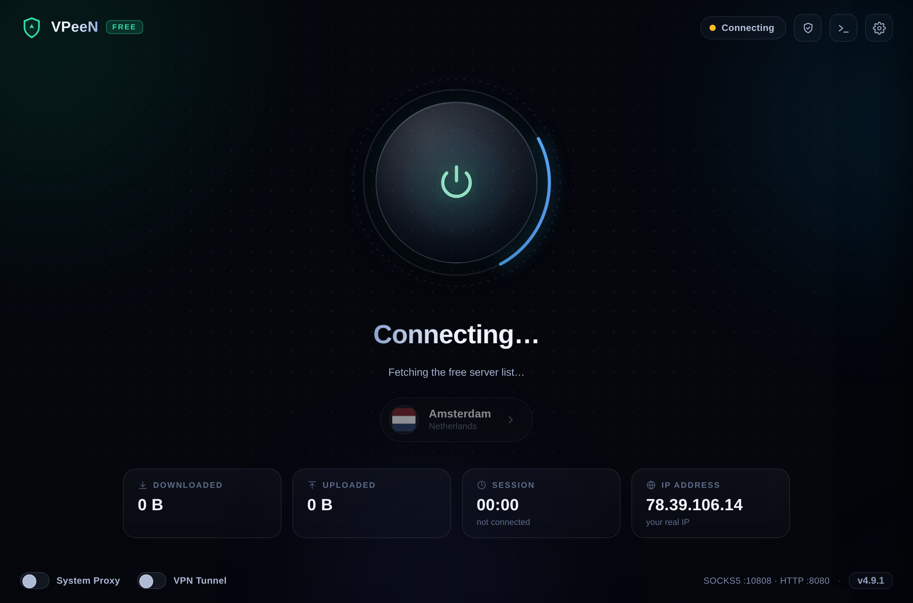
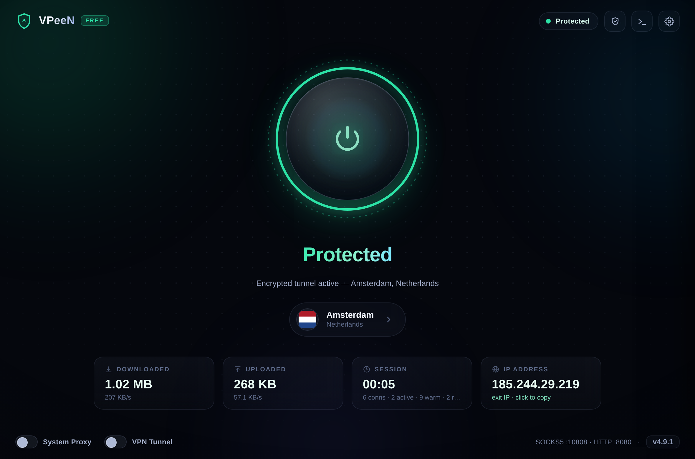
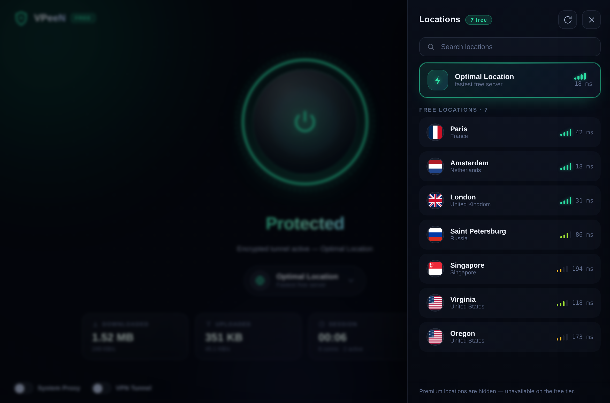
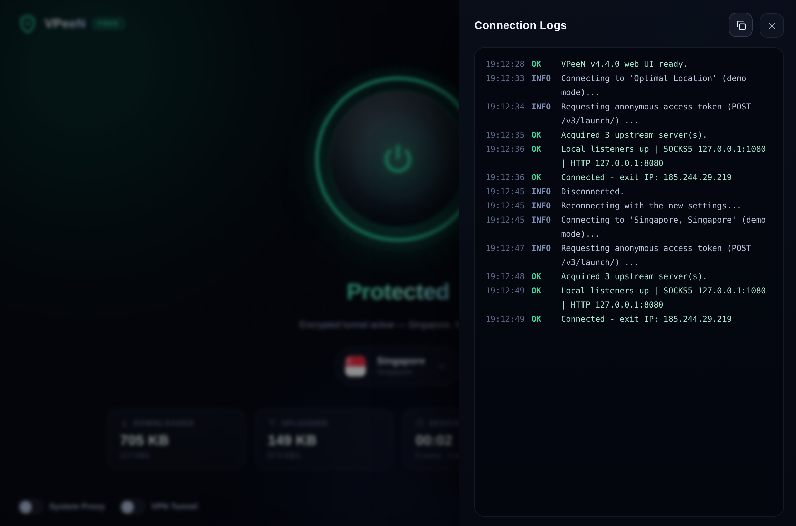
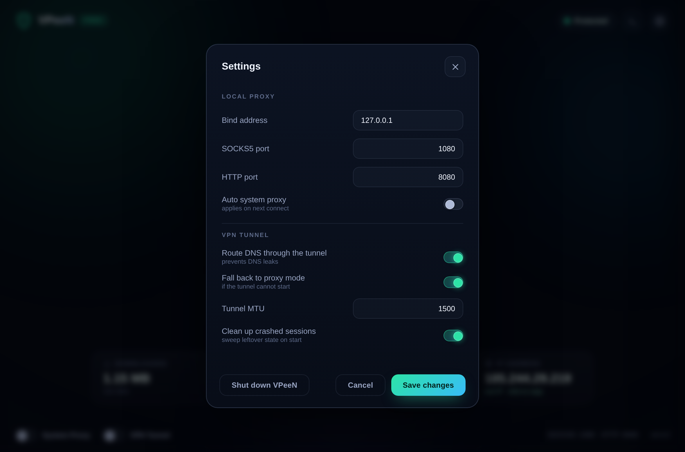

<div align="center">



# 🛡️ VPeeN

### The free VeePN browser-extension network — for your entire operating system.

**شبکه رایگان افزونه VeePN — این بار برای کل سیستم‌عامل تو.**

`No login` · `No subscription` · `No browser needed` · `Pure-Python core`

[](LICENSE)
[](#-quick-start)
[](https://www.python.org/)
[](CHANGELOG-v4.9.0.md)
[](../../releases)
[](../../stargazers)

[Quick start](#-quick-start) · [Tunnel mode & kill switch](#-tunnel-mode--a-real-vpn-the-hiddify-way) · [FAQ](#-faq) · [Version history](#-version-history) · [🇮🇷 راهنمای فارسی](#-راهنمای-فارسی)


</div>

---

## 💡 Why VPeeN?

The VeePN Chrome extension is free, needs no account, and tunnels browser traffic through a
global proxy network. **VPeeN** speaks the same protocol natively and brings those tunnels to
**every app on your machine** — wrapped in a product-grade desktop interface.

- 🖥️ **System-wide** — browsers, games, download managers, CLIs: everything is covered
- 🙈 **Anonymous** — guest tokens only, nothing to sign up for
- 🚪 **Browser-free** — Chrome can stay closed; VPeeN talks to the network directly
- 🧩 **Standard interfaces** — plain SOCKS5 and HTTP proxies on localhost
- 🪟 **A real Windows installer (v4.9)** — `VPeeN-Setup-x.y.z.exe`: Start Menu, uninstaller, zero UAC
- 🧱 **Leak-proof by design (v4.9)** — a firewall-grade kill switch, a one-click self-check,
  split tunneling and a Persian (RTL) UI on top of the v4.8 auto-updater
- ⚡ **Fast by construction (v4.5–v4.7)** — pre-warmed TLS connections, hedged connects and
  throughput-ranked servers: every proxied connection costs ~1 round-trip, a stalled server
  costs 0.35 s instead of 8 s, and repeated DNS lookups are answered from a local cache
- 🎨 **“Aurora” GUI (v4.4)** — an animated power orb, drifting aurora gradients, live
  latency bars and realtime traffic stats — a local web app in a native window
  (pywebview) or your browser. No Tk, no Electron, no heavy frameworks
- 🆓 **Free-tier honest** — the list shows the 7 locations the free network actually
  serves, with real measured latency; the 178 premium ones are hidden instead of failing


## ✨ Features

| | Feature | Details |
|---|---|---|
| ⚡ | **One-click connect** | A big, honest power orb — pulse while connecting, glow when protected, red arc on error |
| 🌍 | **Location picker** | Flag-tagged list of the free locations, live search, real measured latency bars, “Optimal” auto-pick |
| 📡 | **Realtime stats** | Down/up totals **with live rates**, session timer, connection counters — updated every second |
| 🕵️ | **IP monitor** | Real IP when offline, exit IP when protected — one click to copy |
| 🔒 | **Real VPN Tunnel (TUN)** | Hiddify-style full-system tunnel — every app, zero config (see below) |
| 🖥️ | **System proxy mode** | Classic SOCKS5/HTTP mode with a one-switch OS setup + clean restore on exit |
| 🛡️ | **DNS leak protection** | In tunnel mode DNS is relayed through the tunnel itself |
| 🧱 | **Kill switch (v4.9)** | If the tunnel breaks mid-session, traffic is **firewalled and blocked** — never leaked — while VPeeN repairs it automatically (netsh on Windows, iptables on Linux); a red lockdown state when repair fails |
| 🩺 | **Protection self-check (v4.9)** | One click runs 8 honest checks — exit-IP leak, DNS privacy, routing, kill switch, QUIC/WebRTC side channels — on your live connection, no third-party sites |
| 🇮🇷 | **فارسی + RTL (v4.9)** | The whole UI speaks Persian with a proper right-to-left layout — Settings → Language |
| 🔀 | **Split tunneling (v4.9)** | A bypass list (`*.ir`, your bank…) keeps chosen domains DIRECT in proxy mode — Windows/macOS/GNOME, restored on disconnect |
| 📜 | **Activity log** | Color-coded, autoscrolling, one-click copy — every step of every connection |
| ⚙️ | **Settings** | Ports, bind, tunnel MTU, DNS relay, fallback policy, crash cleanup — all validated on save |
| 🔁 | **Self-healing tunnels** | Round-robin across servers, automatic retry and credential rotation on failure |
| ♿ | **Accessible & smooth** | Full keyboard operation, focus rings, `prefers-reduced-motion` support |
| 📦 | **Zero runtime deps** | The core engine is pure Python standard library — the GUI is plain HTML/CSS/JS |

<div align="center">

**The connect flow** — idle · connecting · protected

  

**The app** — locations · logs · settings

  

</div>

## 🚀 Quick Start

### Option 1 — Ready-made binaries

Download from [**Releases**](../../releases):

| File | OS | Run |
|---|---|---|
| `VPeeN-Setup-x.y.z.exe` | Windows 10/11 | **double-click → installs & launches** (no admin needed) |
| `VPeeN-Windows.zip` | Windows 10/11 | portable alternative — unzip → `VPeeN.exe` |
| `VPeeN-macOS.zip` | macOS 10.13+ | unzip → `VPeeN.app` — see the [macOS first-launch note](#-macos-first-launch-gatekeeper) |
| `VPeeN-Linux.tar.gz` | Linux x64 | extract → `./VPeeN` |
| `VPeeN-Chrome-Extension.zip` | Chrome 108+ | unzip → [load unpacked](#-chrome-extension--vpeen-bridge) |

> 🪟 **Windows:** grab the **Setup exe** — a real installer (Start Menu shortcuts, an
> optional desktop icon and an *Apps & Features* entry with an uninstaller) that installs
> per-user into `%LOCALAPPDATA%\Programs\VPeeN`, so **no UAC / admin rights** are needed.
> The zip stays for portable use (USB stick, restricted machines); both get the same
> automatic in-app updates.

> Windows/macOS open the UI in a native desktop window (pywebview); Linux (and any machine
> without a webview backend) opens it in your default browser — same UI, same features.

### 🍏 macOS first launch (Gatekeeper)

VPeeN is free, open-source software — and **not** wrapped in a paid Apple Developer
certificate. On modern macOS (Sequoia and **Tahoe 26**) Gatekeeper answers that with
*“Apple could not verify ‘VPeeN’ is free of malware…”* and no visible Open button.
It is a warning, not a defect — the binary is ad-hoc code-signed since v4.6.0. Two ways
past it:

1. **The two-click way** — try to open the app once, then
   **System Settings → Privacy & Security** → scroll to the bottom →
   **“Open Anyway”**. macOS asks once; after that it opens normally forever.
2. **The one-line way** — Terminal:
   ```bash
   xattr -cr /Applications/VPeeN.app     # (or the path where you unzipped it)
   ```
   This removes the quarantine flag Apple put on the download.

### 🧩 Chrome extension — VPeeN Bridge

Want *only the browser* on the VPN while the rest of the system stays direct — or the
one-click switch while VPeeN runs? **VPeeN Bridge** (ships as
`VPeeN-Chrome-Extension.zip` on every release, source in [`extension/`](extension/)):

1. Unzip it anywhere permanent.
2. `chrome://extensions` → enable **Developer mode** → **Load unpacked** → pick the folder.
3. Click the VPeeN icon → flip **“Route Chrome through VPeeN”**.

Two permissions only (`proxy`, `storage`), remote DNS through the tunnel, and the same
localhost/LAN bypass list as the desktop app. Flip it off and Chrome is instantly direct
again.

### Option 2 — Run from source

```bash
git clone https://github.com/SirBNL/VPeeN.git
cd VPeeN
pip install -r requirements.txt     # optional: native window (pywebview)
python main.py
```

The app starts, shows your real IP, fetches free locations with live latency — press the power orb.

### Option 3 — Headless CLI

No GUI needed (servers, routers, scripts):

```bash
python -m vpeen.cli list                 # list free locations + latency
python -m vpeen.cli test nl              # full chain test: token → server → exit IP
python -m vpeen.cli run --region us-va   # SOCKS5 :1080 + HTTP :8080
python -m vpeen.cli run --best           # auto-pick the optimal region
python -m vpeen.cli export nl            # print the raw upstream config
```

Then point any app at:

```
SOCKS5 :  socks5://127.0.0.1:1080
HTTP   :  http://127.0.0.1:8080
```

## ⚙️ How it works

VPeeN reproduces what the free VeePN extension does inside the browser — but for the whole OS:

1. **Anonymous session** — VPeeN obtains a guest access token, exactly like the extension.
   No account is ever created.
2. **Locations & servers** — the free location list and per-session credentials are fetched
   from VeePN's live infrastructure, so the app keeps working as endpoints evolve.
3. **Local proxy** — VPeeN listens as a standard SOCKS5 + HTTP proxy on `127.0.0.1`
   (a non-loopback bind without credentials is refused outright).
4. **Tunneling** — every connection is relayed through an encrypted tunnel to the selected region.
5. **System switch** — optionally flips the OS proxy on (Windows / macOS / GNOME) and restores
   the previous state on exit.

The GUI itself is a tiny loopback-only web app: a stdlib HTTP server runs the proxy core and
streams events to the UI over a long-poll `/api/poll` endpoint — the interface reacts in
under a second with zero third-party JavaScript.

## 🔒 Tunnel Mode — a real VPN, the Hiddify way

Flip the **VPN Tunnel** switch and VPeeN stops being “just a proxy” and becomes
a **system-wide VPN**: a virtual network adapter takes over all of your traffic — not just the
apps that know about proxies.

```mermaid
flowchart LR
    A["🖥️ ALL apps + DNS"] --> B["🔌 VPeeN TUN adapter"]
    B --> C["tun2socks userspace TCP/IP stack"]
    C -->|"socks5 over loopback"| D["VPeeN core"]
    D -->|"encrypted tunnel"| E["🌍 VeePN network"]
    E --> F["Internet"]
    style D fill:#0f766e,color:#d7fbee,stroke:#2de3a7
    style A fill:#0e1526,color:#eaf1fb,stroke:#22304d
    style B fill:#0e1526,color:#eaf1fb,stroke:#22304d
    style C fill:#0e1526,color:#eaf1fb,stroke:#22304d
    style E fill:#0e1526,color:#eaf1fb,stroke:#22304d
    style F fill:#0e1526,color:#eaf1fb,stroke:#22304d
```



Under the hood this is the same architecture Hiddify / sing-box use: a TUN device
([wintun](https://www.wintun.net/) on Windows, `utun` on macOS, `tun` on Linux) driven by the
open-source [tun2socks](https://github.com/xjasonlyu/tun2socks) engine (MIT), which VPeeN
launches as a properly elevated helper and points at its own local SOCKS5.

### Built to never break your internet

| Safety mechanism | What it means for you |
|---|---|
| 🚫 **No route hijack** | VPeeN adds two `/1` routes instead of replacing your default gateway — disconnect = instant, clean restore |
| 🧭 **Anti-loop routes** | The VPN servers themselves are pinned to your real gateway, so the tunnel can never route into itself |
| 🏠 **LAN stays up** | Local network traffic (printers, NAS, router admin) is untouched |
| 📡 **DNS through the tunnel** | The TUN adapter's DNS points at VPeeN's internal relay — your system DNS settings are never modified |
| 🛑 **Explicit failure, never silent** | If the tunnel drops, you SEE it: a loud warning explains that coverage is now partial — or, with the fallback switch turned off, VPeeN stops instead of quietly downgrading you to proxy mode |
| 💓 **Heartbeat watchdog** | If the GUI dies, the elevated helper notices within seconds and tears everything down |
| 🧹 **Crash journal** | Every route change is journaled to disk; after a hard crash the next launch cleans up automatically |
| ♻️ **Adapter auto-removal** | The wintun adapter lives only as long as the process — kill anything, Windows cleans itself |

> ℹ️ Tunnel mode needs **administrator rights once per connect** (UAC prompt on Windows,
> pkexec / osascript on Linux / macOS) — that is how real VPN apps create a network device.
> Everything else (proxy mode) works without elevation.

| | Proxy mode | 🔒 Tunnel mode |
|---|---|---|
| Coverage | Apps that use the OS proxy / SOCKS5 | **Every app — TCP; DNS is tunneled too. Non-DNS UDP (e.g. QUIC) is not relayed: apps that can, fall back to TCP on their own** |
| Admin rights | not needed | once per connect (UAC) |
| DNS | resolved by your system | relayed through the tunnel |
| Best for | browsers, quick use | full protection, stubborn apps, TCP-heavy apps |

### 🧱 Kill switch — blocked, never leaked (v4.9)

When tun2socks dies mid-session, the TUN adapter — and with it the hijack routes —
dies too. Without a kill switch every packet then silently leaves through your
real gateway while the UI still says *Protected*. v4.9 closes that hole:

1. **Detect** — the elevated worker polls tun2socks every second.
2. **Contain** — tagged firewall rules (`VPeeN-KS`) drop all non-loopback
   outbound traffic: `netsh` on Windows, `iptables`/`ip6tables` on Linux.
   (macOS: detection + repair, no firewall primitive — documented limitation.)
3. **Repair** — tun2socks is respawned, the hijack routes re-bound to the new
   adapter, the DNS relay restarted — and only once the tunnel is *proven* back
   does the containment lift. The repair path has no leak window.
4. **Lockdown** — if repair fails 3×, the containment stays: a red
   *Kill Switch ON* state; one click disconnects (full restore) or retries.

The rules are journaled with the session (crash recovery removes them), engage
is delete-then-add, release is idempotent, and the startup sweep removes stale
rules even without a session file — **no rule survives “start the app once.”**
With the kill switch on, a dead GUI leaves the blackhole in place (offline, not
leaking) instead of silently restoring direct traffic.
Toggle: Settings → VPN tunnel → **Kill switch** (default on, tunnel mode only).

### 🩺 Doctor — the one-click protection self-check (v4.9)

The shield button in the top bar runs 8 checks against your live connection —
exit-IP leak detection, routing coverage, DNS privacy, kill-switch state,
system proxy, QUIC/WebRTC side channels — without contacting any third-party
“what is my IP” site. Results are sorted problems-first and localized.

### 🔀 Split tunneling (v4.9, proxy mode)

Settings → Local proxy → **Bypass list**: domains like `*.ir` or your bank's
site connect DIRECT while the system proxy is on. The previous exception list
is backed up and restored byte-for-byte on disconnect. CLI equivalent:
`python -m vpeen.cli run --region nl --set-system --bypass "*.ir"`.
Tunnel mode ignores the list on purpose — a full tunnel is a full tunnel.

## 🏗️ Build from source

```bash
pip install pyinstaller
pyinstaller vpeen.spec --noconfirm
```

- **Windows** → `dist/VPeeN.exe`  ·  **macOS** → `dist/VPeeN.app`  ·  **Linux** → `dist/VPeeN`

Every push is built for all three platforms by [GitHub Actions](.github/workflows/build.yml);
version tags (`v*`) automatically produce a [release](../../releases) with binaries —
on Windows the **Setup installer** is compiled with Inno Setup from
[`installer/vpeen.iss`](installer/vpeen.iss).

## 📁 Project structure

```
VPeeN/
├── main.py               # GUI launcher (+ tunnel-worker dispatch, crash log)
├── vpeen/
│   ├── gui.py            # desktop window launcher (pywebview → browser fallback)
│   ├── webui.py          # local web-UI server + core/tunnel bridge (loopback only)
│   ├── web/              # the "Aurora" GUI (index.html / style.css / app.js, EN+FA)
│   ├── core.py           # background proxy engine + GUI event bridge
│   ├── api.py            # VeePN network client (tokens, locations, servers)
│   ├── upstream.py       # encrypted upstream tunnels
│   ├── localproxy.py     # local SOCKS5 + HTTP servers
│   ├── tunnel.py         # VPN tunnel orchestration (elevated worker + controller)
│   ├── tunnel_platforms.py  # per-OS TUN routes / DNS / session journal
│   ├── killswitch.py     # firewall-grade kill switch (detect → contain → repair)
│   ├── doctor.py         # 8-check protection self-check (Doctor)
│   ├── dnsrelay.py       # DNS relay that tunnels DNS through VPeeN
│   ├── systemproxy.py    # OS proxy switch + bypass list (Win / macOS / GNOME)
│   ├── selfupdate.py     # one-click self-updater (+ installed-version sync)
│   ├── settings.py       # persistent app settings (atomic writes)
│   ├── cli.py            # headless command-line mode
│   └── utils.py          # shared helpers
├── installer/vpeen.iss   # Inno Setup script → VPeeN-Setup-x.y.z.exe (CI)
├── extension/            # "VPeeN Bridge" Chrome extension (MV3)
├── assets/               # icon, logo, banner, flags/ (92 circular flags)
├── scripts/              # fetch-binaries + 11 verification suites + release canary/tools
├── docs/                 # screenshots + demo GIF
└── .github/workflows/    # multi-OS build + release pipeline (test gate + release canary)
```

## 🧾 Third-party components

| Component | License | Usage |
|---|---|---|
| [tun2socks](https://github.com/xjasonlyu/tun2socks) v2.7.0 | **MIT** | TUN engine for Tunnel mode (fetched at build time, never at runtime) |
| [wintun](https://www.wintun.net/) 0.14.1 | Wintun Prebuilt Binaries License | signed virtual-adapter driver (Windows, used via its permitted API) |
| [pywebview](https://pywebview.ngole.io/) | BSD-3 | native desktop window for the web GUI (optional; falls back to the browser) |
| [Inno Setup](https://jrsoftware.org/isinfo.php) | Inno Setup License | compiles the Windows installer in CI (build-time only) |
| Flags | [flagcdn](https://flagcdn.com/) (public domain) | circular country flags |

## 📜 Version history

| Version | Codename | Highlights | Full notes |
|---|---|---|---|
| **v4.9.0** | **Sangar** (سنگر) | Windows Setup installer · firewall kill switch · Persian RTL UI · split tunneling · Doctor self-check | [CHANGELOG-v4.9.0.md](CHANGELOG-v4.9.0.md) |
| v4.8.0 | Sentinel | Tunnel-mode root-cause fixes (the “connected but dead” blackhole, stale hijack routes) · one-click self-updater · CI test gate | [CHANGELOG-v4.8.0.md](CHANGELOG-v4.8.0.md) |
| v4.7.0 | Nitro | Hedged connects + resolver singleflight — tail latency 8 s → 0.35 s · adaptive warm pool | [CHANGELOG-v4.7.0.md](CHANGELOG-v4.7.0.md) |
| v4.6.0 | Turbo | 3.4× faster connection setup · throughput-ranked servers · Chrome extension · macOS Gatekeeper fixes | [CHANGELOG-v4.6.0.md](CHANGELOG-v4.6.0.md) |
| v4.5.0 | Velocity | Pre-warmed TLS pool · Happy-Eyeballs racing · latency-ranked servers | [CHANGELOG-v4.5.0.md](CHANGELOG-v4.5.0.md) |
| v4.4.0 | Aurora | The local-web-app GUI · live latency + traffic rates · 12-fix audit pass | [CHANGELOG-v4.4.0.md](CHANGELOG-v4.4.0.md) |
| v4.3.x | — | Security pass: proxy auth, bind safety, UDP-DNS ASSOCIATE, secrets hygiene | [CHANGELOG-v4.3.1.md](CHANGELOG-v4.3.1.md) |

## ❓ FAQ

<details>
<summary><b>Is an account or subscription required?</b></summary>
No. VPeeN uses the same anonymous guest-token flow as the free browser extension.
</details>

<details>
<summary><b>Which locations are free?</b></summary>
Currently 7 free locations (Amsterdam, Paris, London, Virginia, Oregon, Singapore, Saint Petersburg).
The app fetches the live list — run <code>python -m vpeen.cli list</code> to see it.
</details>

<details>
<summary><b>Is this a “real” VPN?</b></summary>
With <b>Tunnel mode</b> — yes for TCP and DNS: a virtual network adapter routes your system's
TCP traffic through the VPN tunnel with DNS leak protection, exactly like Hiddify/sing-box do it.
Being honest about the limits: the upstream is an HTTPS-CONNECT (TCP-only) proxy, so <b>non-DNS
UDP (QUIC, VoIP, games) is not relayed</b> — QUIC-capable apps fall back to TCP on their own,
others need TCP. In classic proxy mode it is a system-wide SOCKS5/HTTP proxy with the same limits.
Since v4.3.0 the local SOCKS5 also answers <b>UDP ASSOCIATE for DNS</b> (relayed as DNS-over-TCP
through the tunnel), which keeps tun2socks-based setups working.
</details>

<details>
<summary><b>What does the kill switch protect me from?</b></summary>
The moment the tunnel worker dies, the firewall containment drops all non-loopback traffic
while VPeeN repairs the tunnel — so nothing leaks through your real gateway in the gap.
If repair fails, the containment stays (a red <i>Kill Switch ON</i> state) until you act.
It is on by default in tunnel mode; rules are journaled and swept on the next launch, so
a crashed VPeeN can never brick your internet.
</details>

<details>
<summary><b>Where is my data stored?</b></summary>
Only <code>~/.vpeen/</code> on your machine — cached token, servers and settings. Nothing is sent
anywhere else. The state file (which contains the access token) is written with <code>0600</code>
permissions and the directory with <code>0700</code> (POSIX), so only your user can read it.
</details>

<details>
<summary><b>Antivirus flags the binary?</b></summary>
PyInstaller onefile builds are sometimes heuristically flagged. Build from source with
<code>pyinstaller vpeen.spec</code> if you prefer — the code is fully readable right here.
</details>

## ⚠️ Disclaimer

This project is published **for educational and research purposes** — it demonstrates how a
browser-extension proxy client works. Using the free extension network outside the browser may
conflict with VeePN's Terms of Service; you are responsible for how you use this software.
Respect the laws of your country and the networks you connect to.

---

<div align="center" dir="rtl">

# 🇮🇷 راهنمای فارسی

**VPeeN** همون شبکه‌ای رو که افزونه رایگان VeePN توی مرورگر در اختیارت می‌ذاره، برای
**کل سیستم‌عامل** باز می‌کنه — با رابط گرافیکی «Aurora» مدرن و انیمیشنی، بدون ثبت‌نام و بدون نیاز به کروم.

## ✨ ویژگی‌ها

- ⚡ **اتصال با یک کلیک** — اورب پاور بزرگ: موقع اتصال می‌تپه، موقع محافظت می‌درخشه، موقع خطا قرمز می‌شه
- 🌍 **انتخاب موقعیت** — لیست لوکیشن‌های رایگان با پرچم کشور، جستجوی زنده و **پینگ واقعیِ اندازه‌گیری‌شده** برای هر سرور + انتخاب خودکار «بهترین»
- 📡 **آمار زنده** — حجم دانلود/آپلود **با نرخ لحظه‌ای**، تایمر جلسه و شمارنده اتصال‌ها، هر ثانیه آپدیت
- 🕵️ **مانیتور IP** — زمان قطع: IP واقعی تو؛ زمان اتصال: IP خروجی — با یک کلیک کپی می‌شه
- 🔒 **تانل واقعی VPN (حالت TUN)** — تانل کامل مثل Hiddify؛ کل ترافیک سیستم بدون هیچ تنظیماتی
- 🧱 **کیل‌سوئیچ (۴.۹)** — اگه تانل وسط کار بشکنه، ترافیک به‌جای لو رفتن **مسدود** می‌شه و خودکار تعمیر می‌شه
- 🩺 **خودآزمایی محافظت (۴.۹)** — دکمهٔ سپر: ۸ بررسی صادقانه روی اتصال زنده (لو رفتن IP، DNS، کیل‌سوئیچ، QUIC/WebRTC)
- 🔀 **لیست عبور مستقیم (۴.۹)** — دامنه‌هایی مثل `*.ir` یا سایت بانک مستقیم بمونن، بقیه از تانل
- 🇮🇷 **رابط فارسی راست‌به‌چپ (۴.۹)** — تنظیمات → زبان → فارسی؛ کل چیدمان RTL می‌شه
- 🖥️ **حالت پروکسی سیستم** — SOCKS5/HTTP کلاسیک با ست/بازیابی خودکار پروکسی سیستم‌عامل
- 🛡️ **ضد نشت DNS** — در حالت تانل، خود DNS هم از داخل تانل رد می‌شه
- 📜 **لاگ کامل فعالیت** — رنگی، اسکرول خودکار، با یک کلیک کپی
- ⚙️ **تنظیمات** — پورت‌ها، MTU تانل، رله DNS، سیاست fallback، پاک‌سازی بعد از کرش — همه موقع ذخیره اعتبارسنجی می‌شن
- 🔁 **تانل خودترمیم** — توزیع بار بین سرورها و تلاش مجدد خودکار
- ♿ **دسترس‌پذیر** — کاملاً با کیبورد کار می‌کنه و حرکت‌های انیمیشن رو برای کاربران حساس کاهش می‌ده

## 🔒 حالت تانل — یک VPN واقعی، مثل Hiddify

کلید **VPN Tunnel** رو بزن تا VPeeN از «فقط یک پروکسی» به یک **VPN سراسری واقعی** تبدیل بشه:
یک کارت شبکه مجازی کل ترافیک سیستم رو می‌گیره — حتی برنامه‌هایی که مفهوم پروکسی رو نمی‌فهمن.

همون معماری Hiddify و sing-box: آداپتور TUN ([wintun](https://www.wintun.net/) در ویندوز، `utun` در مک،
`tun` در لینوکس) که با موتور متن‌باز [tun2socks](https://github.com/xjasonlyu/tun2socks) (مجوز MIT) راه می‌افته.

### طوری ساخته شده که اینترنتت رو خراب نکنه

| مکانیزم امنیتی | یعنی چی؟ |
|---|---|
| 🚫 **بدون دستکاری روت پیش‌فرض** | به‌جای عوض‌کردن گیت‌وی سیستم، فقط دو مسیر `/1` اضافه می‌شه؛ قطع اتصال = برگشت فوری و تمیز |
| 🧭 **مسیر ضد حلقه** | IP سرورهای VPN به گیت‌وی اصلی قفل می‌شن تا تانل هیچ‌وقت داخل خودش نیفته |
| 🏠 **شبکه محلی سالم می‌مونه** | ترافیک LAN (پرینتر، NAS، پنل مودم) دست‌نخورده |
| 📡 **DNS از داخل تانل** | DNS آداپتور مجازی به رله داخلی VPeeN اشاره می‌کنه؛ تنظیمات DNS سیستم تو هیچ‌وقت عوض نمی‌شه |
| 🛑 **خطای شفاف، نه سکوت** | اگه تانل بیفته، صریح می‌بینی — یا با خاموش‌کردن سوییچ fallback، VPeeN کلاً می‌ایسته تا مخفی‌وار به پروکسی برگرده |
| 💓 **نگهبان ضربان** | اگه رابط گرافیکی بمیره، هلپر با دسترسی ادمین ظرف چند ثانیه همه‌چیز رو برمی‌گردونه |
| 🧹 **ژورنال کرش** | تک‌تک تغییرات مسیرها روی دیسک ثبت می‌شه؛ بعد از کرش سخت، اجرای بعدی خودش پاک می‌کنه |
| ♻️ **حذف خودکار آداپتور** | آداپتور wintun فقط تا وقتی پروسه‌اش زنده‌ست وجود داره |

> ℹ️ حالت تانل به **دسترسی ادمین (یک بار در هر اتصال)** نیاز داره (UAC در ویندوز) — همین قانون برای همه VPN های واقعی برقراره. حالت پروکسی بدون هیچ دسترسی خاصی کار می‌کنه.

| | حالت پروکسی | 🔒 حالت تانل |
|---|---|---|
| پوشش | برنامه‌هایی که پروکسی سیستم رو می‌فهمن | **تمام برنامه‌ها — TCP؛ DNS هم از تانل. UDP غیر-DNS (مثل QUIC) رله نمی‌شه و برنامه‌های توانا خودشون به TCP برمی‌گردن** |
| دسترسی ادمین | لازم نیست | یک بار در هر اتصال |
| DNS | با DNS خود سیستم | از داخل تانل |
| مناسب برای | مرورگر، استفاده سریع | محافظت کامل، برنامه‌های سرسخت |

## 🚀 نصب و اجرا

**روش ۱ — فایل آماده:** از [Releases](../../releases) نسخه سیستمت رو بگیر:

| فایل | سیستم‌عامل | اجرا |
|---|---|---|
| `VPeeN-Setup-x.y.z.exe` | ویندوز ۱۰/۱۱ | **دابل‌کلیک → نصب و اجرا** (بدون نیاز به ادمین) |
| `VPeeN-Windows.zip` | ویندوز ۱۰/۱۱ | نسخهٔ پرتابل — باز کن → `VPeeN.exe` |
| `VPeeN-macOS.zip` | مک ۱۰.۱۳+ | باز کن → `VPeeN.app` *(برای بار اول، پایین رو بخون)* |
| `VPeeN-Linux.tar.gz` | لینوکس ۶۴بیتی | باز کن → `./VPeeN` |
| `VPeeN-Chrome-Extension.zip` | کروم ۱۰۸+ | باز کن → Load unpacked |

> 🪟 **ویندوز:** فایل **Setup** رو بگیر — یک نصب‌کنندهٔ واقعیه (میان‌بر منوی استارت،
> آیکون دسکتاپ اختیاری، و آیتم Uninstall در Apps & Features) که برای کاربر فعلی در
> `%LOCALAPPDATA%\Programs\VPeeN` نصب می‌شه و **هیچ دسترسی ادمینی/UAC نمی‌خواد**.
> نسخهٔ zip برای حالت پرتابل باقی می‌مونه؛ هر دو آپدیت خودکار داخل برنامه رو دارن.

> 🍏 **کاربران مک (Sequoia / Tahoe 26):** چون VPeeN مجانی و متن‌بازه و گواهی پولی Apple Developer
> نداره، اولین بار Gatekeeper با پیام «Apple could not verify…» جلوی اجرا رو می‌گیره — این هشداره،
> نه خرابی. راه‌حل: یک بار سعی کن بازش کنی، بعد برو **System Settings → Privacy & Security**
> و پایین صفحه روی **Open Anyway** بزن؛ از اون به بعد مستقیم باز می‌شه. یا در Terminal:
> `xattr -cr /Applications/VPeeN.app`

**روش ۲ — اجرا از سورس:**

```bash
git clone https://github.com/SirBNL/VPeeN.git
cd VPeeN
pip install -r requirements.txt
python main.py
```

**روش ۳ — خط فرمان (بدون رابط گرافیکی):**

```bash
python -m vpeen.cli list                  # لیست لوکیشن‌های رایگان + پینگ
python -m vpeen.cli test nl               # تست کامل زنجیره
python -m vpeen.cli run --region us-va    # SOCKS5 :1080 + HTTP :8080
python -m vpeen.cli export nl             # نمایش کانفیگ خام آپ‌استریم
```

بعد هر برنامه‌ای رو به این آدرس‌ها وصل کن:

```
SOCKS5 :  socks5://127.0.0.1:1080
HTTP   :  http://127.0.0.1:8080
```

## 🆕 تازه‌های نسخه ۴.۹ (Sangar — سنگر)

- 🪟 **نصب‌کنندهٔ واقعی ویندوز** — فایل `VPeeN-Setup-x.y.z.exe` با میان‌بر منوی استارت،
  Uninstaller در Apps & Features و بدون هیچ UAC (نصب per-user مثل VS Code). نسخهٔ پرتابل zip
  هم مثل قبل هست.
- 🧱 **کیل‌سوئیچ** — اگه تانل وسط کار بشکنه، ترافیک به‌جای لو رفتن **مسدود** می‌شه (فایروال
  netsh/iptables) و خودکار تعمیر می‌شه؛ اگه تعمیر نشد، حالت قرمز «کیل‌سوئیچ فعال» می‌مونه.
  قوانین در ژورنال ثبت می‌شن و با یک بار اجرای برنامه پاک می‌شن — اینترنتت گیر نمی‌کنه.
- 🇮🇷 **رابط فارسی راست‌به‌چپ** — تنظیمات → زبان → فارسی؛ کل UI با چیدمان RTL.
- 🩺 **خودآزمایی محافظت (Doctor)** — دکمهٔ سپر: ۸ بررسی صادقانه روی اتصال زنده (لو رفتن IP،
  DNS، مسیریابی، کیل‌سوئیچ، QUIC/WebRTC) بدون هیچ سایت خارجی.
- 🔀 **لیست عبور مستقیم (Split Tunneling)** — تو حالت پروکسی، دامنه‌هایی مثل `*.ir` یا سایت بانک
  رو مستقیم نگه دار؛ موقع قطع، دقیقاً به حالت قبلی برمی‌گرده.
- ✅ **۴۳۴ تست در ۱۱ مجموعه** قبل از انتشار سبز شد (۵ مجموعهٔ جدید برای همین قابلیت‌ها).

## 🆕 تازه‌های نسخه ۴.۸ (Sentinel — نگهبان)

- **رفع ریشه‌ای باگ‌های حالت تانل** — باگ «متصل ولی بی‌شبکه» در اولین اتصال، روت‌های
  به‌جا‌مانده بعد از کرش و مسمومیت DNS بعد از hijack؛ همه با مجموعه‌تست اختصاصی قفل شدن.
- **به‌روزرسانی خودکار با یک کلیک** — برنامه خودش نسخهٔ جدید رو پیدا، دانلود و نصب می‌کنه
  و ری‌استارت می‌شه.
- **دروازهٔ تست CI** — از این نسخه به بعد هیچ انتشار بدون سبز شدن کل تست‌ها انجام نمی‌شه.

> جزئیات کامل نسخه‌های قدیمی‌تر: [۴.۷ Nitro](CHANGELOG-v4.7.0.md) · [۴.۶ Turbo](CHANGELOG-v4.6.0.md) ·
> [۴.۵ Velocity](CHANGELOG-v4.5.0.md) · [۴.۴ Aurora](CHANGELOG-v4.4.0.md)

## ❓ سوالات متداول

<details>
<summary><b>نیاز به ثبت‌نام یا خرید اشتراک هست؟</b></summary>
نه. VPeeN دقیقاً مثل افزونه رایگان، توکن مهمان ناشناس می‌گیره. هیچ حسابی ساخته نمی‌شه.
</details>

<details>
<summary><b>کدوم لوکیشن‌ها رایگانه؟</b></summary>
الان ۷ لوکیشن رایگانه (آمستردام، پاریس، لندن، ویرجینیا، اورگن، سنگاپور، سن‌پترزبورگ).
لیست زنده رو خود اپ می‌گیره.
</details>

<details>
<summary><b>VPN واقعیه؟</b></summary>
با <b>حالت تانل</b> — آره: یک کارت شبکه مجازی کل ترافیک TCP سیستم رو با حفاظت نشت DNS از تانل رد می‌کنه،
دقیقاً مثل Hiddify و sing-box. در حالت پروکسی کلاسیک، یک پروکسی سراسری SOCKS5/HTTP داری.
</details>

<details>
<summary><b>کیل‌سوئیچ از چی محافظت می‌کنه؟</b></summary>
لحظه‌ای که تانل می‌میره، فایروال تا زمان تعمیر کل ترافیک غیر-loopback رو می‌بنده — هیچ چیزی
در فاصلهٔ تعمیر از گیت‌وی واقعی تو بیرون نمی‌ره. اگه تعمیر نشد، مسدود می‌مونه (حالت قرمز) تا خودت تصمیم بگیری.
پیش‌فرض روشنه و قوانینش ژورنال می‌شن؛ حتی بعد از کرش، یک بار اجرای برنامه همه‌چیز رو پاک می‌کنه.
</details>

<details>
<summary><b>اطلاعاتم کجا ذخیره می‌شه؟</b></summary>
فقط در <code>~/.vpeen/</code> روی سیستم خودت: توکن کش‌شده، سرورها و تنظیمات.
</details>

## ⚠️ سلب مسئولیت

این پروژه با هدف **آموزش و پژوهش** منتشر شده و نشان می‌دهد کلاینت پروکسی یک افزونه مرورگر چطور کار می‌کند.
استفاده از شبکه رایگان افزونه خارج از مرورگر ممکن است با شرایط استفاده VeePN در تضاد باشد؛ مسئولیت نحوه استفاده با شماست.
قوانین کشور خودتان را رعایت کنید.

</div>

---

<div align="center">
<br/>
<b>⭐ If VPeeN saved you some money, a star is the best thank-you.</b><br/>
<a href="../../stargazers"></a>
<br/><sub>v4.9.0 “Sangar” · pure-Python core · zero-dependency GUI</sub>
</div>
